# Controle Portaria

Sistema web **multi-tenant** de controle de acesso para portarias de condomínio. Registra entradas e saídas de moradores, visitantes e prestadores de serviço, além de autorizações de acesso, eventos com lista de convidados, ocorrências e relatórios.

Cada condomínio acessa o sistema pelo próprio subdomínio (`demo.seudominio.com`) e os dados de um condomínio nunca aparecem para outro.

## Telas

### Dashboard e acessos

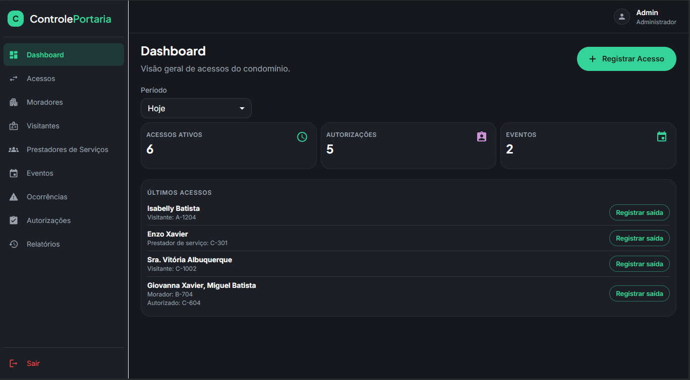

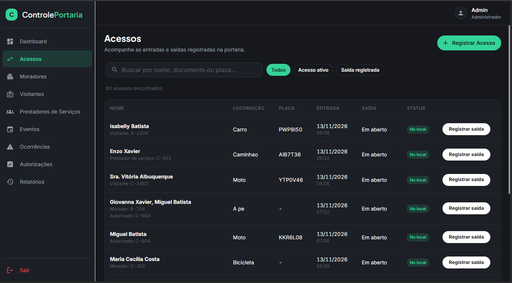

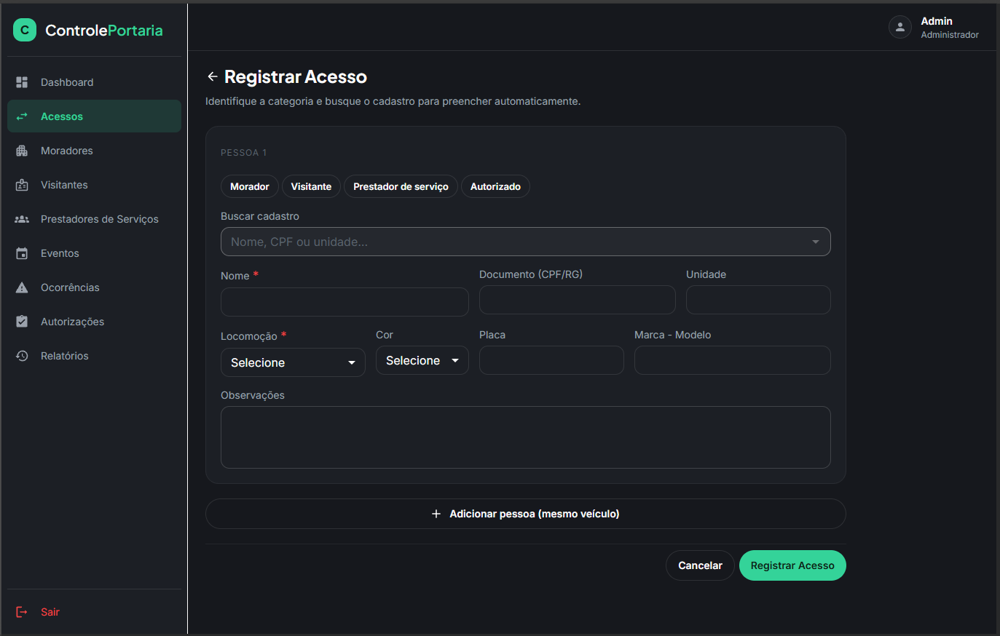

### Versão mobile

<p>
  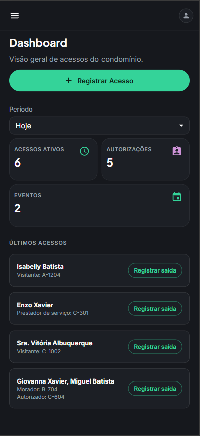
  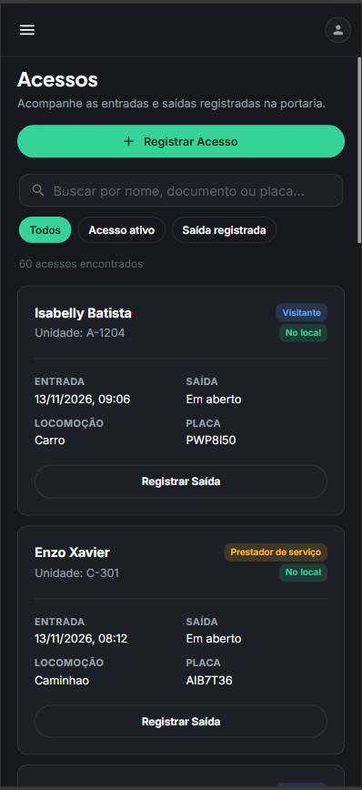
</p>

### Cadastros

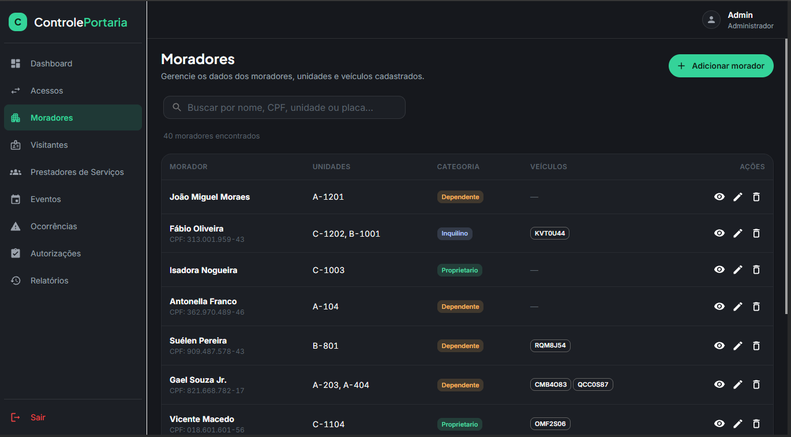

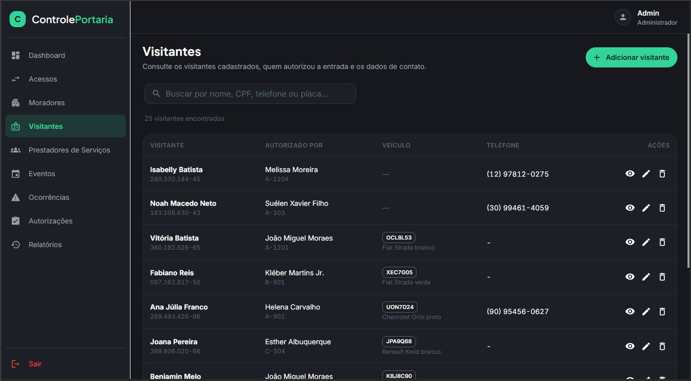

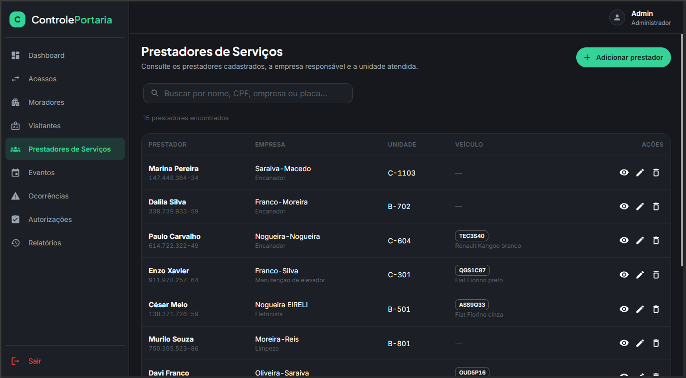

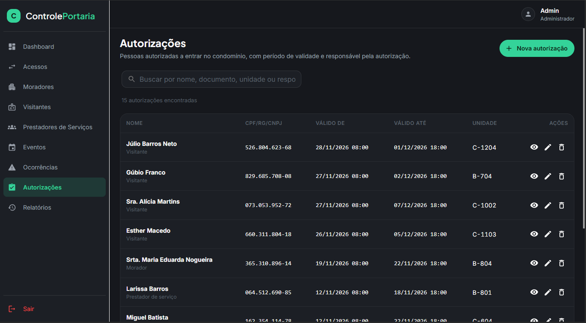

### Eventos

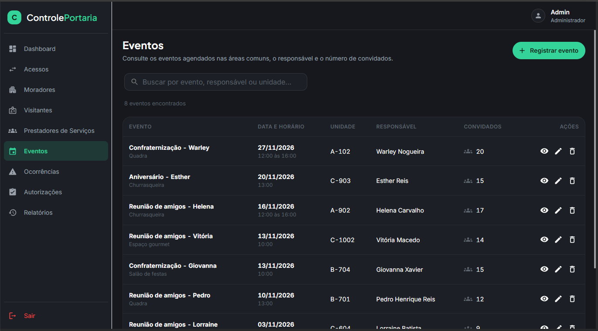

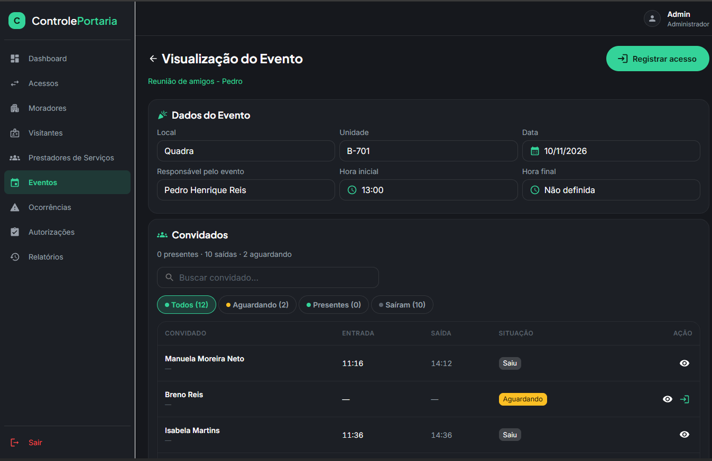

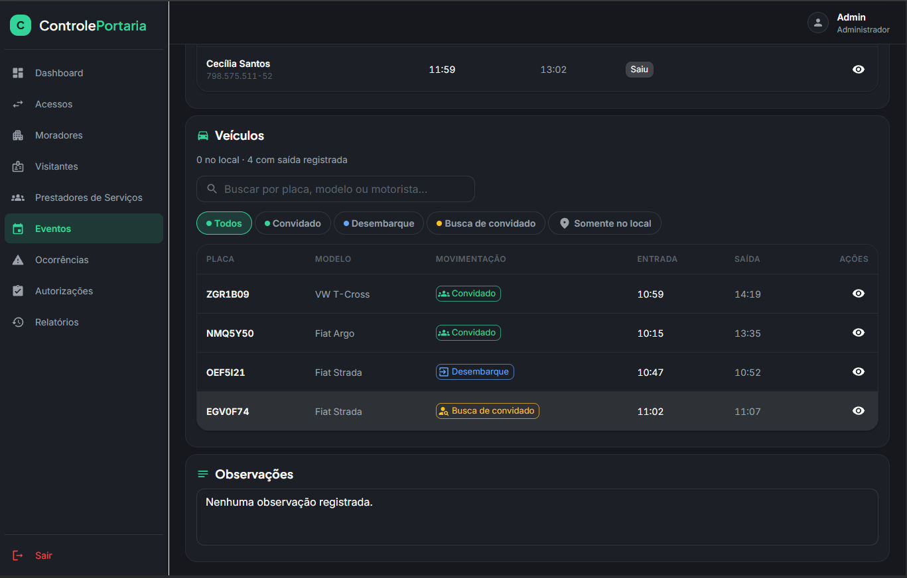

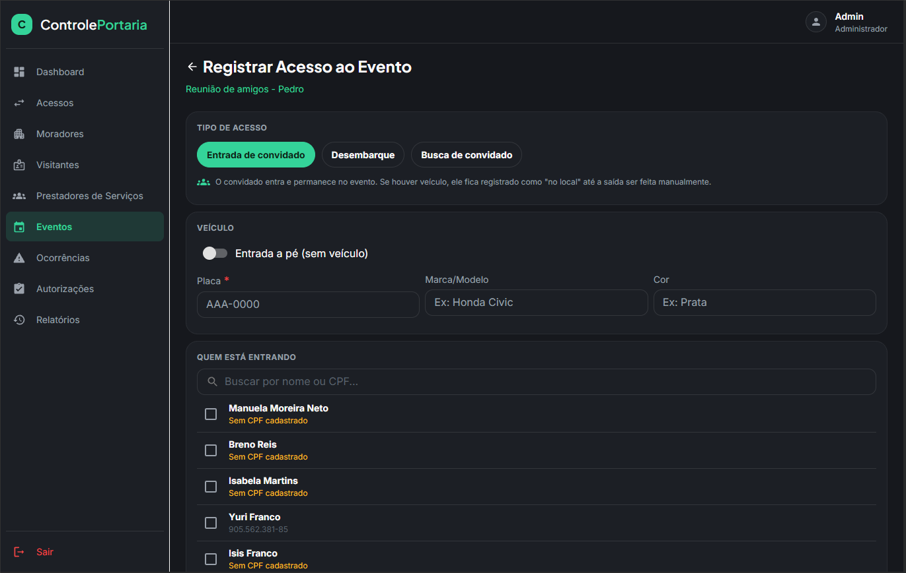

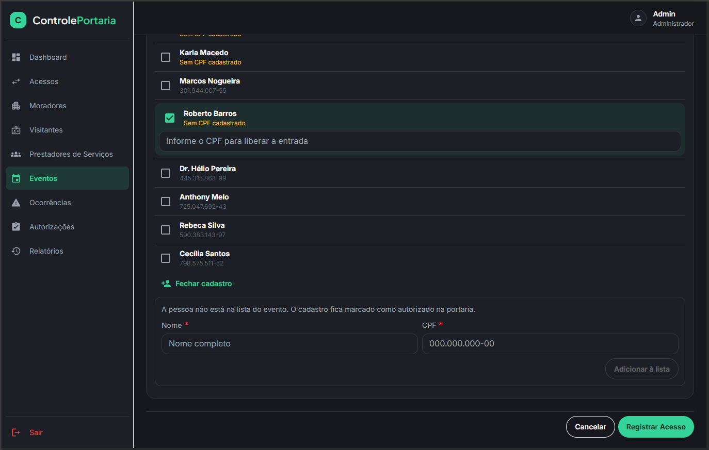

### Ocorrências e relatórios

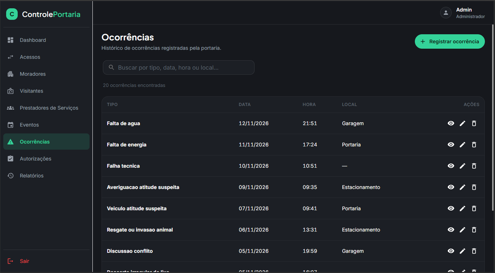

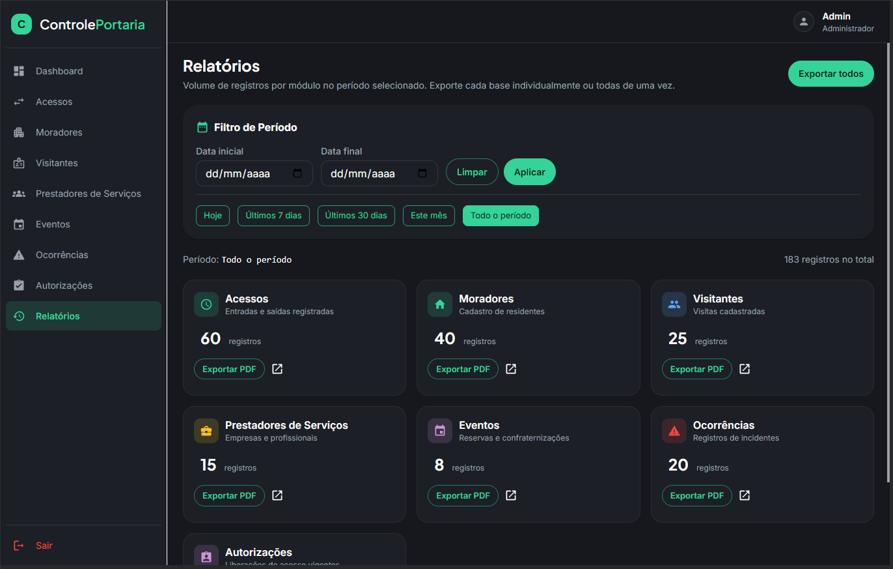

## Funcionalidades

- **Registros de acesso**: entrada e saída de moradores, visitantes e prestadores, com acessos em aberto
- **Cadastros**: moradores (proprietário, inquilino, dependente), visitantes, prestadores de serviço e veículos
- **Autorizações** de acesso com período de validade (vencidas, vigentes e futuras)
- **Eventos** com convidados e controle de veículos (convidado, desembarque, busca)
- **Ocorrências** da portaria
- **Dashboard** com indicadores por período
- **Relatórios** exportáveis em PDF
- **Perfis de usuário**: `ADMIN`, `GESTOR`, `SINDICO` e `SEGURANCA`
- Layout responsivo, com listas próprias para mobile

## Destaques técnicos

- **Multi-tenancy por subdomínio**: toda tabela de domínio carrega `condominiumId`, e o tenant é sempre derivado do JWT, nunca do corpo da requisição. Cada módulo tem testes de integração provando que o condomínio B não lê nem altera dados do condomínio A (404 em GET/PATCH/DELETE por id).
- **Criptografia de dados pessoais**: e-mail, telefone, documento, placa e observações são gravados com AES-256-GCM e só são descriptografados na camada de serviço.
- **BFF (Backend for Frontend)**: o Next.js nunca fala com o banco. Os Route Handlers em `web/src/app/api/*` guardam o JWT em cookie `httpOnly` e repassam as chamadas para a API Express, então o token não fica exposto ao JavaScript do navegador.
- **Segurança da API**: `helmet`, rate limiting, limite de tamanho de body, senhas com bcrypt, verificação de variáveis obrigatórias em produção e um secret de plataforma para criar condomínios e o primeiro admin.
- **Testes**: Vitest + Supertest com Postgres real na API, Vitest + Testing Library + jsdom no frontend. Contratos de teste reutilizáveis cobrem rotas BFF, services, hooks de listagem e de mutação.
- **Arquitetura modular**: na API, cada domínio segue `routes → controller → service → types`; no frontend, cada domínio tem `components/`, `mobile/` e `hooks/`.

## Arquitetura

```text
Navegador ──► Next.js (web :3000)
               ├─ páginas (App Router, MUI, React Query)
               └─ BFF /app/api/*  ── cookie httpOnly com JWT
                        │  HTTP + Bearer
                        ▼
              Express API (api :3333) ── Prisma ──► PostgreSQL
               auth · authorize · tenant isolation · criptografia de PII
```

## Stack

| Camada   | Tecnologias                                                                                                   |
| -------- | ------------------------------------------------------------------------------------------------------------- |
| Frontend | Next.js 16 (App Router), React 19, TypeScript, MUI 7, React Query 5, TanStack Table 8, React Hook Form, jsPDF |
| Backend  | Express 5, Prisma 7, PostgreSQL, JWT, bcrypt, helmet, express-rate-limit                                      |
| Testes   | Vitest 4, Supertest, Testing Library, jsdom                                                                   |
| Infra    | Docker / Docker Compose, pnpm workspaces                                                                      |

## Rodando localmente (início rápido)

```bash
./scripts/setup-env.sh
docker compose -f docker-compose.yml -f docker-compose.dev.yml up --build -d -V
docker compose exec api pnpm seed
```

Acesse http://demo.localhost:3000 e entre com `admin@demo.local` / `Senha@123`. Os outros perfis estão em [Dados de teste (seed)](#dados-de-teste-seed).

---

# Documentação técnica

## Pré-requisitos

- Node.js 20+
- pnpm 9+

## Instalação

```bash
pnpm install
```

## Estrutura do Monorepo

```text
.
├─ web/              # Aplicação frontend (Next.js)
├─ api/              # API backend (Express + PostgreSQL)
├─ package.json      # Scripts de atalho na raiz
└─ pnpm-workspace.yaml
```

## Desenvolvimento (Frontend)

```bash
pnpm dev
```

Acesse [http://localhost:3000](http://localhost:3000).

## Scripts

| Comando             | Descrição                               |
| ------------------- | --------------------------------------- |
| `pnpm dev`          | Executa o frontend em `web`             |
| `pnpm build`        | Build de produção do frontend           |
| `pnpm start`        | Inicia o frontend em modo produção      |
| `pnpm lint`         | Lint do frontend (`web`)                |
| `pnpm format`       | Formata todos os pacotes do workspace   |
| `pnpm format:check` | Verifica formatação em todos os pacotes |

## Executar pacote específico

Frontend:

```bash
pnpm --filter ./web dev
```

API:

```bash
pnpm --filter ./api <script>
```

## Docker (API + Web + PostgreSQL)

O `docker compose` lê variáveis do arquivo `.env` na raiz do repositório. Comece criando esse arquivo a partir do exemplo:

```bash
./scripts/setup-env.sh
```

Suba todo o ambiente com um único comando:

```bash
docker compose up --build
```

Serviços disponíveis:

- Frontend: http://localhost:3000
- API: http://localhost:3333/api
- PostgreSQL: localhost:5432

Para rodar em background:

```bash
docker compose up --build -d
```

Para parar os serviços:

```bash
docker compose down
```

Para remover também o volume do banco:

```bash
docker compose down -v
```

Arquivos de exemplo disponíveis:

- `.env.example`: variáveis usadas pelo `docker compose`
- `api/.env.example`: variáveis para rodar a API localmente fora do Docker

> O `.env.example` vem com os valores em branco e o `docker-compose.yml` **exige** `POSTGRES_PASSWORD`, `JWT_SECRET`, `DATA_ENCRYPTION_KEY` e `PLATFORM_SETUP_SECRET`; sem eles o `docker compose` não sobe. O script `./scripts/setup-env.sh` cria o `.env` com valores aleatórios (`openssl rand -hex 32`). Em produção, use segredos próprios e nunca reaproveite os do ambiente de desenvolvimento.

### Docker (Desenvolvimento com Hot Reload)

Para desenvolvimento com atualização automática (hot reload) no frontend e backend, use o arquivo de override `docker-compose.dev.yml`.

Subir ambiente dev:

```bash
docker compose -f docker-compose.yml -f docker-compose.dev.yml up --build -d -V
```

Acompanhar logs do web e api:

```bash
docker compose -f docker-compose.yml -f docker-compose.dev.yml logs -f web api
```

Parar ambiente dev:

```bash
docker compose -f docker-compose.yml -f docker-compose.dev.yml down
```

Com esse modo:

- `web` roda com `next dev` (Turbopack)
- `api` roda com `tsx watch`
- alterações em `web/` e `api/` são refletidas automaticamente sem rebuild completo da imagem
- `node_modules` de `web` e `api` vêm da imagem (volumes anônimos), não do host — não é preciso rodar `pnpm install` na máquina para usar o Docker
- a flag `-V` (`--renew-anon-volumes`) recria esses volumes a cada `up`; sem ela, depois de mudar dependências o container continuaria usando o `node_modules` antigo

## Dados de teste (seed)

O script [`api/scripts/seed.ts`](api/scripts/seed.ts) popula o banco com dados fictícios (gerados com `@faker-js/faker`) em todos os módulos, para testes locais.

O que ele faz:

- Cria (ou recria) o condomínio de teste com slug `demo`. **Apaga e recria apenas os dados desse condomínio** — os demais ficam intactos.
- Gera usuários, moradores (alguns com mais de uma unidade), visitantes, prestadores de serviço, autorizações (vencidas, vigentes e futuras), registros de acesso (incluindo alguns em aberto), eventos com convidados/veículos e ocorrências.
- Usa uma semente fixa (`faker.seed(42)`), então cada execução gera os mesmos dados.
- Só roda contra banco local: é bloqueado se `NODE_ENV=production` ou se o host do `DATABASE_URL` não for `localhost`, `127.0.0.1` ou `postgres`.

> As migrações precisam estar aplicadas e o client Prisma gerado antes de rodar o seed.

Pelo Docker (ambiente dev, que já roda `prisma generate` e `migrate deploy` ao subir a API):

```bash
docker compose -f docker-compose.yml -f docker-compose.dev.yml up --build -d -V
docker compose exec api pnpm seed
```

Fora do Docker (Postgres acessível em `localhost:5432`, usando `api/.env`):

```bash
pnpm --filter ./api prisma:generate
pnpm --filter ./api exec prisma migrate deploy
pnpm --filter ./api seed
```

> Se o `prisma:generate` falhar com `EACCES`, a pasta `api/src/generated` foi criada pelo Docker como `root`. Corrija com `sudo chown -R $USER api/src/generated`.

Acesse http://demo.localhost:3000 com um dos usuários abaixo (senha `Senha@123`):

| Perfil      | E-mail                 |
| ----------- | ---------------------- |
| `ADMIN`     | `admin@demo.local`     |
| `GESTOR`    | `gestor@demo.local`    |
| `SINDICO`   | `sindico@demo.local`   |
| `SEGURANCA` | `seguranca@demo.local` |

## Testes

```bash
pnpm test                               # todos os pacotes
pnpm --filter ./api test:unit           # API sem banco
pnpm --filter ./api test:integration    # API com Postgres (requer api/.env.test)
pnpm --filter ./web test                # frontend
```

Para os testes de integração, copie `api/.env.test.example` para `api/.env.test`. O banco precisa ser local e o nome dele deve terminar em `_test`.

## Licença

[MIT](LICENSE)
